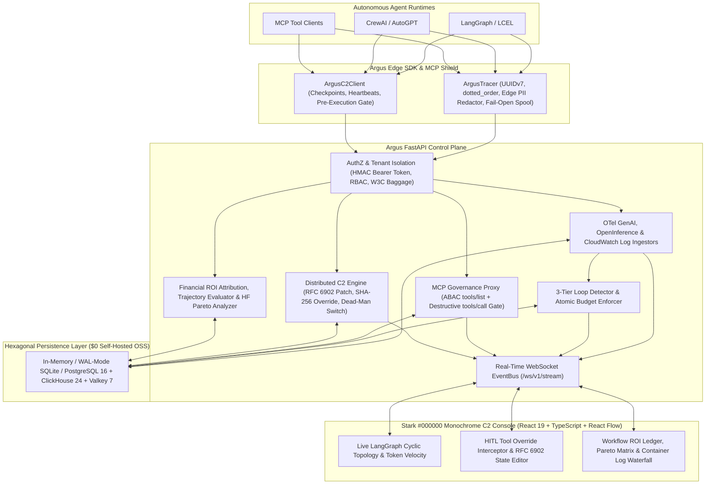

<p align="center">
  <picture>
    <source media="(prefers-color-scheme: dark)" srcset="dashboard/public/argus_logo_white.png">
    
  </picture>
</p>

<h1 align="center">ARGUS</h1>

<p align="center">
  <strong>Zero-Tolerance Governance, Observability & Command & Control (C2) Plane for Autonomous AI Agents</strong>
</p>

<p align="center">
  <a href="#quickstart"></a>
  <a href="#quickstart"></a>
  <a href="#quickstart"></a>
  <a href="#quickstart"></a>
  <a href="#quickstart"></a>
  <a href="#quickstart"></a>
  <a href="LICENSE"></a>
</p>

<p align="center">
  <a href="#quickstart">Quickstart</a> •
  <a href="#system-architecture">Architecture</a> •
  <a href="#core-engineering-capabilities">Core Capabilities</a> •
  <a href="#3-line-agent-sdk-instrumentation-example">Python SDK</a> •
  <a href="#option-a-single-command-docker-deployment-recommended">Docker Deployment</a>
</p>

<p align="center">
  <sub>Argus is an enterprise-grade AgentOps governance, telemetry, and Command & Control (C2) control plane engineered to monitor, intercept, evaluate, and govern autonomous AI agents (LangGraph, LCEL, CrewAI, AutoGPT, and Model Context Protocol runtimes) at scale with zero tolerance for runaway loops, budget depletion, or unauthorized destructive tool execution.</sub>
</p>

---

## System Architecture



---

## Core Engineering Capabilities

### 1. Cross-Platform Telemetry SDK & OpenTelemetry / OpenInference Pipeline
- **Chronological `UUIDv7` & `dotted_order` Hierarchy**: Every span carries a RFC 9562 `UUIDv7` identifier and a lexicographically sortable `dotted_order` path (`<timestamp>Z<uuid>.<child_timestamp>Z<child_uuid>`), enabling $O(1)$ prefix subtree reconstruction without recursive SQL CTEs.
- **Dual Semantic Conventions**: Normalizes traces across **OpenTelemetry GenAI (`gen_ai.*`)** and **Arize Phoenix OpenInference (`openinference.span.kind`)** simultaneously.
- **Framework Instrumentors**: Built-in non-invasive adapters for **LangGraph**, **LCEL**, **CrewAI**, and **AutoGPT**, plus an `@tracer.trace(...)` decorator.
- **Edge PII & Secret Scrubbing**: Deterministic regex + Shannon entropy redaction strips API keys, bearer tokens, AWS credentials, SSNs, and emails *before* spans leave the worker process.
- **Fail-Open Local Spooling**: If telemetry storage is unreachable, spans automatically spool to `.argus_logs/spool_spans.jsonl` so observability outages never crash customer agents.

### 2. 3-Tier Automated Loop Circuit Breaker & Atomic Budget Guard
Argus evaluates every reasoning step and tool invocation in `< 2 ms` across three detection tiers:
1. **Tier 1 — Exact Signature Hash ($O(1)$)**: Canonical JSON SHA-256 digest of `(tool_name, tool_args)` catches identical repeated tool calls immediately.
2. **Tier 2 — Structural Cycle & SimHash Detection ($O(W)$)**: Detects `A -> B -> A -> B` state oscillations and 64-bit SimHash Hamming distance near-duplicates across a sliding window.
3. **Tier 3 — Cosine Semantic Stagnation**: Computes character $n$-gram TF-IDF cosine similarity $\cos(\vec{v}_t, \vec{v}_{t-1}) \ge 0.90$ across consecutive reasoning steps to halt paraphrased infinite loops.
4. **Pre-Execution Hard Budget Enforcer**: Atomically reserves token and tool spend against tenant/session USD caps, tripping to `TRIPPED_BUDGET` (`HTTP 402 Payment Required`) before upstream LLM calls execute.

### 3. Model Context Protocol (MCP) Governance Proxy
- **`tools/list` RBAC/ABAC Filtering**: Dynamically filters available MCP tools based on the caller's `TenantContext` role (`VIEWER`, `OPERATOR`, `ADMIN`).
- **`tools/call` Pre-Execution Gate & Prompt-Injection Shield**: Scans tool arguments for prompt-injection and command-injection payloads, enforces budget/loop checks, and automatically transitions high-risk/destructive tool calls (`drop_*`, `delete_*`, `exec_*`, `transfer_*`) into `PAUSED_C2` for human authorization.

### 4. Distributed Command & Control (C2) Plane
- **Optimistic Concurrency Memory Patching (RFC 6902)**: Operators inspect and mutate agent memory mid-execution via RFC 6902 JSON Patch operations (`add`, `replace`, `remove`) guarded by `expected_parent_checkpoint_id` (`HTTP 409 Conflict` on stale writes).
- **Cryptographic Tool Override Engine**: Operators can `approve`, `edit` arguments, `mock` output, or `reject` intercepted tool calls, bound by a SHA-256 request digest (`request_digest_sha256`) to prevent TOCTOU tampering.
- **Worker Heartbeats & Dead-Man's Switch**: Distributed workers renew time-bounded leases via `POST /api/v1/c2/{session_id}/heartbeat`; orphaned sessions are automatically reaped (`POST /api/v1/c2/leases/reap`) to `TERMINATED` (`ABORT_SAFE`).
- **Tamper-Evident SHA-256 Audit Ledger**: Every operator intervention and circuit-breaker trip is recorded in a hash-chained SHA-256 compliance ledger verified via `GET /api/v1/c2/{session_id}/audit-log`.

### 5. Financial ROI Attribution & Hugging Face Pareto Efficiency Matrix
- Computes exact **Net Workflow ROI**:
  $$\text{Net ROI (USD)} = (\text{Task Completion} \times \text{Assigned Business Value}) - (\text{LLM Cost} + \text{Tool Cost} + \text{Infra Cost} + \text{Wasted Loop Cost})$$
- Benchmarks active models against **Hugging Face Open LLM / GAIA Leaderboard** profiles to recommend Pareto-optimal open-weight model substitutions (e.g., Qwen-2.5-72B, Llama-3.3-70B, DeepSeek-V3) that preserve accuracy while cutting latency and token spend.

---

## Quickstart

### Option A: Single-Command Docker Deployment (Recommended)
```bash
docker compose up -d
```
Navigating to `http://localhost:8000` automatically redirects web browsers to the **Argus C2 Console** while spinning up persistent SQLite storage, PostgreSQL 16, ClickHouse 24, and Valkey 7 (`$0` self-hosted open-source stack).

---

### Option B: Local Python Execution

```powershell
# 1. Initialize environment & install Argus
python -m venv .venv
.\.venv\Scripts\Activate.ps1
pip install -e ".[dev]"

# 2. Run the 140-test suite, strict Mypy type checker, and Ruff linter
pytest -v
mypy --strict src tests
ruff check src tests

# 3. Launch the unified Control Plane & Dashboard on a single port
python -m argus serve --port 8000
```
Open **`http://localhost:8000`** in any web browser and click **SEED SCENARIO** in the top navigation bar to populate multi-agent LangGraph, CrewAI, and AutoGPT traces, trigger a live recursive loop trip, inspect paused destructive MCP tool calls, and audit the SHA-256 compliance ledger.

---

### 3-Line Agent SDK Instrumentation Example

Connect any autonomous agent runtime to Argus in 3 lines:

```python
from argus.sdk.tracer import ArgusTracer
from argus.core.tenancy import TenantContext, Role

ctx = TenantContext(tenant_id="acme_corp", workspace_id="production", actor_id="agent_alpha", role=Role.OPERATOR)
tracer = ArgusTracer.remote(base_url="http://localhost:8000")

# Decorate or instrument agent reasoning steps:
@tracer.trace(name="research_step", span_kind="agent")
async def execute_agent_step(task_prompt: str) -> str:
    # Argus evaluates loops, enforces budgets, and intercepts destructive tools
    return "Task completed"
```
